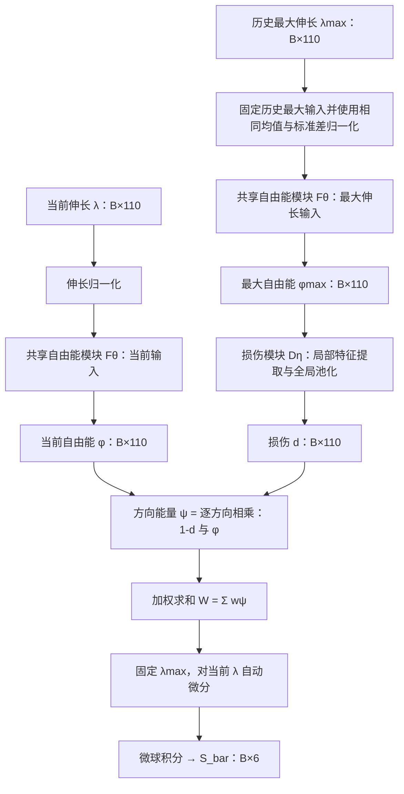

# 最大自由能驱动损伤训练（9 个材料）

本文件和 `train_9_sbar_serial.py` / `pred_9_sbar_serial.py` 新入口默认 `damage_input=maximum_free_energy`；

## 数据流与自动微分

**每个样本使用 110 个当前伸长和 110 个历史最大伸长。两次自由能计算共享同一个 `FreeEnergyModule` 及其参数，不创建第二套网络**。



自由能和损伤模块均为 DeepSets：每方向标量 → `1→64→64→6` 局部特征 → Lebedev 加权池化得到 6 维全局特征 → 拼接为每方向 12 维 → `12→128→128→1` 预测器。自由能末层 Softplus，损伤末层 Sigmoid。最大自由能原样送入损伤模块，不用伸长统计量再次归一化。

这里“最大自由能”定义为 `φmax = Fθ(normalize(λmax))`，并非在完整历史上逐步计算 `max_t Fθ(λ(t))`。网络没有强制能量单调性，且包含跨方向池化，故二者不保证相等；本实现遵循最大伸长先经过自由能模块的指定数据流。

`d = Dη(φmax)`，`φ = Fθ(normalize(λ))`，`W = Σ_a w_a (1-d_a)φ_a`。

求应力时固定历史：`∂W/∂λ_b = Σ_a w_a (1-d_a) ∂φ_a/∂λ_b`。不存在旧串联的 `-φ_a ∂d_a/∂λ_b` 项。DeepSets 跨方向依赖仍完整参与求导，不能随意把方向损伤移到最终积分应力外面。

**代码只对 `λmax` 做 detach，不对 `φmax` 做 detach；**联合训练损失仍能经损伤路径更新共享自由能参数。预热阶段也执行最大应变→最大自由能→损伤前向计算，但损伤模块所有参数冻结。由于初始化时损伤预测器末层权重为零、偏置为 `logit(initial_damage)`，所以预热期间每个方向都固定输出初始损伤；最大自由能虽被计算，但此时不会通过固定损伤输出产生有效的自由能参数梯度。预热主要由当前自由能路径更新自由能模块。联合训练阶段解除损伤冻结，损伤输出开始依赖最大自由能。`forward_sbar` 停在 S_bar，体积分支关闭；通用 `forward` 继续执行 Flory 投影和 Cauchy 转换。

## 沿用的配置

已从 `outputs/9_sbar_warmup_d006_plateau_wide/1/proportional/model.pth` 的 options 和权重形状核对：

| 项目 | 新入口默认值 |
| --- | --- |
| 训练 / 测试 | 双轴训练及验证 / 预拉伸独立测试 |
| 材料 | 1–9，每个单独训练 |
| 自由能预热 / 联合训练 | 100 / 650 epochs；预热固定初始损伤，联合阶段更新损伤 |
| 初始损伤 | 0.06 |
| 学习率 / batch | 0.001 / 256 |
| 联合调度器 | ReduceLROnPlateau，监测验证 loss |
| patience / factor / threshold / min_lr | 40 / 0.5 / 1e-4（相对）/ 1e-5 |
| **预热调度器** | StepLR，step_size=200，gamma=0.5 |
| seed / validation_fraction | 42 / 0.2，按 case 分层随机划分 |
| 局部特征网络 | 1 → 64 → 64 → 6 |
| 自由能 / 损伤预测器 | 12 → 128 → 128 → 1 |

输出仍为 `warmup/`、`proportional/`、`prestretch_test/` 和各材料汇总。默认新目录为 `outputs/9_sbar_maximum_free_energy_d006_plateau_wide`。

## 训练与预测入口

在项目根目录运行，以下为 PowerShell 命令：

```powershell
# 审核全部 9 个材料的数据，不训练
& 'C:/programming/anaconda3/envs/torch/python.exe' train_9_sbar_serial.py --audit-only

# 全部 9 个材料：双轴训练，预拉伸测试（训练结束自动导出两者）
& 'C:/programming/anaconda3/envs/torch/python.exe' train_9_sbar_serial.py
& 'C:/programming/anaconda3/envs/torch/python.exe' train_9_sbar_serial.py --damage-epochs 650

# 可先单独训练一个材料
& 'C:/programming/anaconda3/envs/torch/python.exe' train_9_sbar_serial.py --materials 9

# 从各材料最佳 checkpoint 重新导出双轴和预拉伸预测，不训练
& 'C:/programming/anaconda3/envs/torch/python.exe' pred_9_sbar_serial.py

# 只预测已完成的材料
& 'C:/programming/anaconda3/envs/torch/python.exe' pred_9_sbar_serial.py --materials 9

# 旧架构对照，除损伤输入与输出目录外保持同一配置
& 'C:/programming/anaconda3/envs/torch/python.exe' train_9_sbar_serial.py --damage-input maximum_stretch --output-dir outputs/9_sbar_history_control
```


也可使用通用入口 `train_9_sbar.py --damage-input maximum_free_energy --training-data proportional --initial-damage 0.06`。单数据集训练入口 `train_sbar.py` 同样支持 `--damage-input`。

如要作混合训练对照，传入 `--training-data combined` 和独立 `--output-dir`；预测时也要传入相同两项。这时预拉伸输出是 `prestretch_fit/`，不应作为独立测试性能。

新 checkpoint 保存顶层 `damage_input=maximum_free_energy`，预测按元数据恢复。缺少该字段的旧 checkpoint 仍按 `maximum_stretch` 加载。旧串联 `damage_input=free_energy` 已不再支持，会报错，不能自动解释为新架构；需重新训练。两种现行模式的权重键和形状相同，但互换驱动不等价于重新训练。

## 初始损伤与验证

沿用初始损伤 0.06；损伤末层权重为零，bias 为 `logit(0.06)`。预热全程损伤固定为 0.06，故预热应力已包含约 94% 的初始损伤折减；联合阶段开始时损伤输出仍为 0.06，随后由训练更新。新模式使用历史最大伸长，因此同一当前变形在不同历史下可以产生不同损伤，但网络没有强制损伤单调增长。

此前旧预热实现的回归测试覆盖 110 个最大自由能传递、固定历史的解析应力、历史依赖、双模块训练梯度、初始化、检查点恢复与入口默认值；当前预热语义修改后尚未重新运行测试。此前材料 1 的真实数据短流程使用的是旧预热语义；本次调整后尚未重新运行短流程。完整 100+650 轮训练尚未执行，旧串联实验指标不能作为本架构结果。

## 代码架构位置

| 层次 | 定义位置 | 作用 |
| --- | --- | --- |
| 网络结构 | `constitutive_pinn/networks.py` | 自由能、损伤、体积网络及 DeepSets 特征提取 |
| 损伤驱动与 S_bar 数据流 | `constitutive_pinn/model.py::_compute_sbar` | 两种驱动分支、能量组合、自动微分、微球积分 |
| S_bar 输出接口 | `constitutive_pinn/model.py::forward_sbar` | 检查体积分支关闭并返回 S_bar |
| 完整应力输出接口 | `constitutive_pinn/model.py::forward` | S_bar 后接体积能、Flory 投影与 Cauchy 转换 |
| 物理算子 | `constitutive_pinn/physics.py` | 微球积分、Flory 投影、应力转换 |
| 模块开关 | `constitutive_pinn/config.py::ModelArchitecture` | free_energy / free_energy_damage / full；与损伤驱动配置独立 |
| 三模块分阶段主流程 | `train4.py`、`constitutive_pinn/training.py` | 依次训练自由能、损伤、体积，冻结前阶段最佳权重；预测为 pred2.py |
| 单数据集 S_bar | `train_sbar.py`、`pred_sbar.py` | 无损伤自由能训练，再冻结自由能训练损伤 |
| 九材料 S_bar | `train_9_sbar.py` | 自由能预热后联合训练；默认最大伸长直接驱动损伤 |
| 最大自由能实验入口 | `train_9_sbar_serial.py`、`pred_9_sbar_serial.py` | 复用九材料流程，默认最大自由能驱动损伤与独立输出目录 |

除三模块主流程外，可以按实验入口把 S_bar 实验分为“**最大伸长直接驱动”和“最大伸长先转自由能再驱动”两条路线。**但“最大自由能”和“S_bar”并非并列的两套模型：前者是损伤输入选项，后者是应力输出和监督目标；两条路线都输出 S_bar，底层共用同一个 ModularConstitutivePINN。
